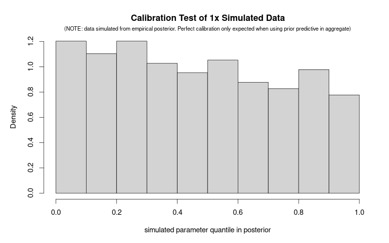
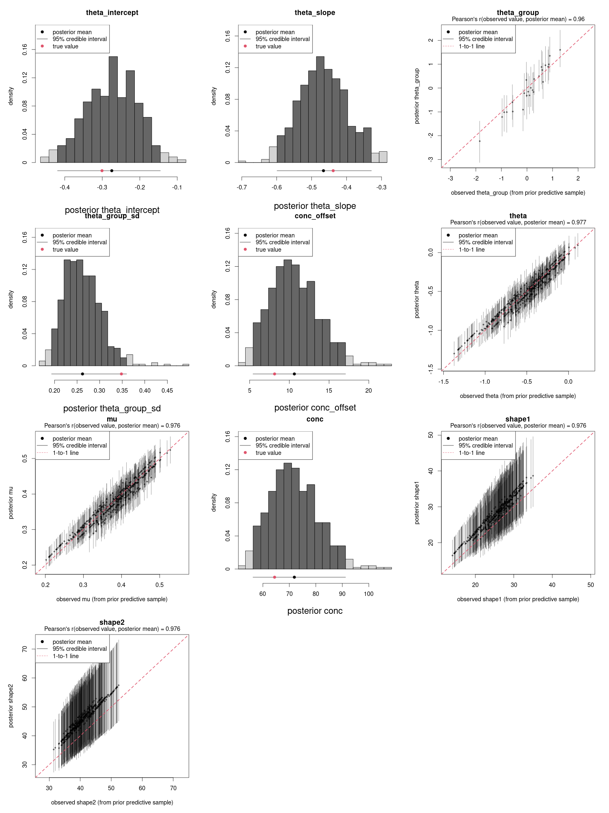
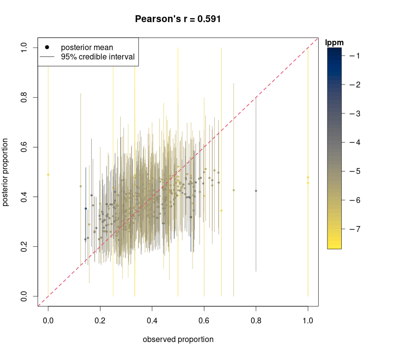

# Stan2R

Stan2R is a set of utilities I wrote to help convert [Stan](https://mc-stan.org/) models to R code. I did this for a few reasons -- sometimes I wanted to more easily perform prior or posterior predictive simulation or to estimate observation-wise posterior probabilities, or I wanted to interactively step through the execution of a complicated model to figure out where something was going wrong. Occasionally I'd want to return to a fitted model and generate quantities for it, and did not want to use [generate_quantities](https://mc-stan.org/docs/cmdstan-guide/generate_quantities_config.html) in CmdStan (where one could much of the same functionality). 

I've also used some of the underlying functions to piece together other utilities, like `flatten_model()`, which takes a conventional multilevel model and converts it to a single-level model according to supplied arguments, either for when we're optimistic and want to troubleshoot pathological posteriors (eg to fix topologically troublesome hyperparameters and determine if they're driving our faulty fits) or for when we're pessimistic and just want to Empirical Bayes things.

Also, collaborators are often unfamiliar with Stan, but are familiar with R. To help them understand a Stan model, I can trivially convert it to interactive R code for ease of exploration and intuition-building.

NOTE: do make sure to inspect any outputted R code for errors. I mostly wrote it with my own style preferences in mind, which may not match your own. I also did not exhaustively implement conversions for all Stan functions or distributions, or even for all features of Stan code (eg custom functions). Depending on the inputted model, you may have to modify converted scripts.

## Example

I wrote a short example (`examples/example.R`) using a small, multilevel beta-binomial model.

In it, I perform:

- **Model Conversion**: Converts Stan model (`models/beta-binomial.stan`) into executable R code.
- **Prior Predictive Simulation**: Generates samples from the model's prior predictive distribution, saving them to `data/beta-binomial_simulated-data.json` and `output/beta-binomial_simulated-params.json`.
- **Model Fitting**: Fits the model to a sample from this prior predictive distribution using CmdStanR.
- **Posterior Predictive Simulation**: Uses the fitted MCMC samples to simulate from the posterior predictive distribution.
- **Posterior Predictive Mass Estimation**: Uses the fitted MCMC samples to compute average fit mass for each observation.
- **Visual Assessment of Calibration**: Visually inspects model calibration by generating histograms of parameter quantiles in each of their marginal joint posterior distributions.
- **Visual Assessment of Model Fit**: Compares posterior predictive means against both "observed" and "unobserved" variables (all of whose true values are known, as they were sampled from the model prior). Visualizes these with scatterplots, alongside estimates of mean log posterior predictive masses and credible intervals.

This outputs a few quick figures, like



(showing quantiles for outcomes -- deviation from uniform(0,1) representing poor calibration)



(showing posterior means and credible intervals for different model parameters, plotted against their true values)



(showing posterior predictive means for observed proportions, plotted against their true values and colored by LPPM)


## Getting Started

### Prerequisites

- R (4.1 or later).
- [CmdStan](https://mc-stan.org/docs/cmdstan-guide/), which provides the Stan compiler `stanc`. Stan2R uses `stanc` to parse and type-check models, so it needs CmdStan even when you never fit a model. The easiest route is CmdStanR:

```R
install.packages("cmdstanr", repos = c("https://stan-dev.r-universe.dev", getOption("repos")))
cmdstanr::install_cmdstan()
```

Stan2R finds `stanc` through `cmdstanr::cmdstan_path()`, then `~/.cmdstan/cmdstan-*/bin/stanc`. To use another one, set `options(stan2r.stanc = "/path/to/cmdstan/bin/stanc")` or the environment variable `STAN2R_STANC`. It was developed against CmdStan 2.38.

### Installation

```R
# install the package
remotes::install_github("NikVetr/Stan2R")
library(Stan2R)

# or, from a clone of this repository
pkgload::load_all("path/to/Stan2R")
```

Stan2R itself has no required R dependencies. The generated R scripts only use base R (helper functions they need are written into the script). The example also uses `cmdstanr`, `posterior`, `data.table`, `jsonlite`, and `viridisLite`.

## Usage

```R
stan_code <- readLines("models/beta-binomial.stan")
dat <- list(n = 400, k = sample(1:200, 400, TRUE), n_groups = 25, group = sample(1:25, 400, TRUE))

# prior predictive simulation: parameters from their priors, data from the likelihood
r_code <- parse_Stan(stan_code, dat = dat, post_pred_sim = FALSE, sim = TRUE)
cat(r_code)                                   # readable R, with the model's comments
env <- new.env(); eval(parse(text = r_code), envir = env)
str(env$out)                                  # every top-level Stan variable

# posterior predictive simulation from one posterior draw (CmdStan column names)
r_code <- parse_Stan(stan_code, dat = dat, samps = draws, sample_index = 10, post_pred_sim = TRUE, sim = TRUE)

# pointwise posterior predictive densities (masses) of the observed data, e.g. for lppd
r_code <- parse_Stan(stan_code, dat = dat, samps = draws, sample_index = 10, post_pred_sim = TRUE, sim = FALSE)
```

The generated script reads data from a list called `dat` and leaves every top-level variable in a list called `out`; in density mode, the observed variables in `out` hold their pointwise densities. `stan2r(program, mode = ...)` is the same translator with named modes (`"prior_predictive"`, `"posterior_predictive"`, `"posterior_density"`, `"prior_density"`), and `stan_program()` returns the parsed, typed program.

Other utilities:

- `flatten_model(stan_code, scale_identifier = "sd_", set_as = 1, put_params_in_data = FALSE)` fixes the parameters whose names match `scale_identifier` (declaring them in transformed data with value `set_as`), or moves them to the data block, and comments out their priors. The rest of the program, including comments, is left as written, and the result is checked with `stanc`.
- `retrieve_block_objects(stan_code, block, type)` lists a block's declarations (`type = "declaration"`) or sampled variables (`type = "sampling"`).

`examples/example.R` runs the whole README workflow; run it from the repository root. Set `STAN2R_EXAMPLE_DIR` to write its data, fits, and figures somewhere other than the repository.

### What is translated

- All program blocks, including user-defined functions; `for`, `foreach`, `while`, `if`/`else`, `break`/`continue`, `print`, `reject`, `fatal_error`.
- Types: `int`, `real`, `vector`, `row_vector`, `matrix`, arrays of any of these, and the constrained types `simplex`, `ordered`, `positive_ordered`, `unit_vector`, `sum_to_zero_vector`, `cholesky_factor_corr`, `corr_matrix`, `cov_matrix`, `cholesky_factor_cov`, offset/multiplier.
- Operators with Stan's meaning for each type (matrix products, left and right division, transposes, integer division and modulus, elementwise operators), indexing with single, multiple and range indexes, and about 200 library functions.
- 57 distributions in Stan's parameterisations, for sampling statements and `*_lpdf`/`*_lpmf`/`*_cdf`/`*_lcdf`/`*_lccdf`/`*_rng` calls, including multivariate ones (`multi_normal`, `multi_normal_cholesky`, `multi_student_t`, `dirichlet`, `lkj_corr_cholesky`, `wishart`, ...), plus the GLM forms `normal_id_glm`, `bernoulli_logit_glm`, `poisson_log_glm` and `neg_binomial_2_log_glm`.
- Truncation `T[L, U]`, and declared bounds on parameters (a bounded prior is drawn from the distribution truncated to the bounds).
- Sampling statements and `target += dist_lpdf(y | ...)` terms, `to_vector(x) ~ ...`, mixtures written with `log_sum_exp(...)`, `log_mix(...)`, or an accumulator (`lp[k] = log(w[k]) + dist_lpdf(y[n] | ...); target += log_sum_exp(lp)`).
- Parameters without a sampling statement whose implied prior is proper: bounded reals (uniform), `simplex`, `unit_vector`, `cholesky_factor_corr`, `corr_matrix`.
- User-defined distributions: simulated with their `_rng` function, or, if there is none, by translating the `_lpdf` body as a small model of its first argument.
- In the prior modes, statements are reordered so each parameter is drawn before the quantities that use it.

### What is not translated

Stan2R stops with an error that names the construct and its line rather than writing code that does not simulate from the model:

- improper priors (a parameter with no sampling statement and an unbounded support);
- sampling statements on transformed parameters, local variables, or expressions such as `log(y) ~ normal(...)` (they need an inverse transform and a Jacobian);
- `target +=` increments that are not density terms (e.g. Jacobians or hand-written log densities) in the prior modes;
- user-defined densities whose body is not built from Stan's own densities, and `_lp` functions;
- higher-order functions (`reduce_sum`, `map_rect`, ODE and algebraic solvers, `integrate_1d`), HMM functions, Gaussian process and `gaussian_dlm_obs` densities, `von_mises`, `wiener`;
- complex numbers and tuples;
- circular dependencies between parameters and transformed parameters through observed data (for example a transformed parameter that uses lagged outcomes).

Two approximations produce a warning instead: a bounded parameter whose prior's arguments depend on other parameters (Stan's joint prior then also includes the truncation's normalising constant), and `ordered` parameters whose prior arguments differ by element.

### Validation

`tests/testthat` checks the parser, the expression translator, every distribution template (normalisation, CDF and quantile consistency, sampler agreement), the modes and error messages, `flatten_model()`, and snapshots of the generated code for the models in `tests/testthat/models`. Run it with `testthat::test_local()` (with CmdStan installed).

Two slower scripts compare against Stan itself (they compile models; at most 4 cores):

- `tests/gold/distributions.R` compares the density and CDF templates with Stan's own functions at fixed points, and the samplers with Stan's `_rng` functions. In the latest run, all 115 log densities and 95 CDF values agreed with Stan's to 1e-7, and draws for 36 of the 37 distributions with an `_rng` matched Stan's (KS or chi-square p > 0.001). The exception is `hypergeometric`: Stan 2.38's `hypergeometric_rng` disagrees with its own `hypergeometric_lpmf` (and fails for some draws), while Stan2R follows the lpmf.
- `tests/gold/models.R` compares prior predictive draws from the generated R code with Stan's prior simulation for 16 models (`tests/gold/models/*_prior.stan` remove the likelihood and either sample continuous outcomes as parameters or draw discrete ones with `_rng`). Means, SDs and 5/50/95% quantiles of 412 quantities (parameters, transformed parameters, simulated data) agreed within Monte Carlo error: the largest |z| was 3.65, and one of 412 exceeded 3, about what chance predicts.

`tests/corpus/run_corpus.R <dirs>` converts a directory of models in three modes and runs the generated code on mock data from `stanc --debug-generate-data`.

### Repository contents

The example's outputs are tracked in git: `models/beta-binomial` is a 3.2 MB compiled macOS executable, and `output/` holds 55 MB of MCMC CSV files and saved fits. Running `examples/example.R` from the repository root overwrites them. They are candidates for removal from the current tree (history unchanged); that is the author's call.

There is no license file yet; `DESCRIPTION` carries a placeholder `License` field until one is chosen.

## Future Updates

Besides general tweaking and testing for usability (eg expanding the range of converted Stan functions, robustness to coding styles and syntax unlike my own), there are a few more features I'm working on incorporating here, such as:

- **MCMC Pathology Diagnosis**: After computing the model graph, identify which intermediate variables are responsible for failures in MCMC diagnostics, allowing for targeted model restructuring.
- **Model-Based Outlier Calling**: Aggregating posterior predictive densities / masses at different levels using flexible regression and classification tools, to see where the model is doing a poor job at capturing interdependence between both included and excluded variables. This can be used to tweak the model, or else provide a principled framework for multivariate outlier calling that can obviate uncertainties in deciding on an appropriate stratification strategy. 
- **Automated Reparameterization**: For model parameters exhibiting MCMC pathology, generating equivalent partially centered or uncentered forms of those models in an automated fashion, integrating with semi-automated exploration of alternative parameterizations during warmup.
- **Extensions to Other Languages**: Eventually generating code for equivalent models for fitting elsewhere, like PyMC or Turing.
- **Improved Model Visualization**: Two in-progress ideas here: 1. a conversion from Stan to LaTeX (and R expression) for potentially easier readability (incl. automatic conversions for glyphs and subscripts), and 2. flowchart generation from Stan code, drawing marginal posterior and prior histograms / KDEs for model variables (with higher dimensional objects drawn as multiple lines on the sample panel)

## Contributing

Contributions or extensions to this program are welcome! If you have suggestions for improvements or new features, please feel free to fork the repository and submit a pull request.
