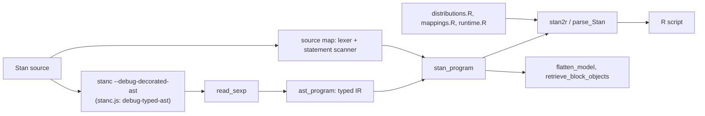

# Stan2R architecture

Stan2R turns a Stan program into an R script that simulates from the model
(prior or posterior predictive) or computes pointwise densities of the observed
data. The Stan compiler is the parser; Stan2R never parses Stan text with
regular expressions.

## Front end (`R/stanc.R`, `R/sexp.R`, `R/ast.R`, `R/source_map.R`, `R/frontend.R`)

- `stanc.R` is the only file that runs a program. It writes the model to a
  temporary file and calls `stanc --debug-decorated-ast`, which prints the
  type-checked AST as an s-expression. A compile error stops with stanc's own
  message. `#include` directives are expanded first with
  `--auto-format --canonicalize=includes`.
- `sexp.R` reads the s-expression into nested R lists.
- `ast.R` converts it into the IR: lists with a `node` field. Every expression
  carries its Stan type (`base`, number of array dimensions) and autodiff level
  (`DataOnly` or `AutoDiffable`, i.e. whether it depends on parameters). Any node
  the converter does not know is an error naming the node and stanc version, so a
  change in stanc's (undocumented, debug-only) dump format fails loudly.
- stanc prints locations as `<opaque>`, so `source_map.R` lexes the original
  text (comments, strings, tokens) and scans statement boundaries only. The
  scanned statements are matched one-to-one with the AST statements, and any
  disagreement is an internal error. This gives every statement its line span,
  character span, leading and trailing comments, and blank-line flags.
- `frontend.R` assembles a `stan2r_program`: blocks of IR statements, a symbol
  table of top-level declarations (block, role, type, constraint), user
  functions, and the source text. Results are cached by source text.

## Translator (`R/translate.R`, `R/translate_expr.R`, `R/mappings.R`, `R/distributions.R`, `R/runtime.R`)

- `translate_expr.R` maps typed expressions to R with precedence-aware
  parenthesisation. Types decide the meaning: `*` becomes `%*%` (wrapped in
  `as.vector()` for matrix-vector products), `sum(a * b)` for row-vector times
  vector, or `outer()`; `int / int` truncates; indexing keeps Stan's result
  shape (`drop = FALSE` where Stan returns a matrix). Representation: vectors and
  row vectors are R vectors; matrices are R matrices; arrays of containers are R
  arrays with the array dimensions first.
- `mappings.R` maps library functions; `distributions.R` holds `r`, `d`, `p`,
  `q` templates for each distribution in Stan's parameterisation.
  `runtime.R` holds base-R helper functions (Laplace CDF, beta-binomial CDF,
  multivariate normal and LKJ samplers, ...) whose source is copied into the
  generated script, so the script runs without Stan2R.
- `translate.R` handles statements and modes:
  - Roles decide what a sampling statement does: data outcomes are drawn
    (simulation modes) or get pointwise log densities (density modes);
    parameters are drawn from their priors (prior modes) or fixed at a posterior
    draw (posterior modes). Sampling statements on transformed parameters or
    local variables, free-form `target +=` terms, and improper priors are
    explicit `stan2r_unsupported` errors with the construct and line.
  - Declared bounds on a parameter truncate its prior (inverse-CDF sampling, or
    rejection when no quantile function exists), unless the bound equals the
    distribution's support. When the truncation's normaliser depends on other
    parameters, the generated code differs from Stan's joint prior and Stan2R
    warns.
  - In the prior modes, transformed-parameter and model statements are
    reordered by a stable topological sort of their reads and writes, so every
    parameter is drawn before it is used.
  - Mixtures: `log_sum_exp(...)`, `log_mix(...)`, and accumulators
    (`lp[k] = w + dist_lpdf(y | ...); target += log_sum_exp(lp)`) draw a
    component and then the outcome; on bounded parameters, components are
    weighted by their mass inside the bounds.
  - User-defined functions are translated to R functions. A user-defined
    distribution is simulated with its `_rng` when there is one, otherwise from
    a draw function derived from its `_lpdf` body.
- `draws.R` reshapes posterior draws (CmdStan or `data.frame()`-mangled column
  names) to declared shapes and writes them as R literals.

## Stan-to-Stan (`R/flatten.R`, `R/stan_text.R`)

`flatten_model()` and `retrieve_block_objects()` use the IR and the source
spans: edits replace character ranges of the original text, so comments and
layout survive, and the result is re-checked with stanc. `stan_text.R` prints IR
back as Stan for messages and new declarations.

## Validation (`tests/`)

- `tests/testthat`: s-expression reader, front end (types, lines, comments,
  includes), expressions (shapes, precedence, integer arithmetic), the
  distribution table (normalisation, CDF and quantile consistency, sampler
  agreement), modes, errors, `flatten_model()`, and per-model snapshots of the
  generated code for the committed models in `tests/testthat/models`.
- `tests/corpus/run_corpus.R`: converts a directory of models in three modes and
  runs the generated code on mock data from `stanc --debug-generate-data`.
- `tests/gold/distributions.R`: Stan's `_lpdf`/`_lpmf`, CDFs, and `_rng` draws
  against the templates (one compiled program, `fixed_param`).
- `tests/gold/models.R`: Stan2R prior predictive draws against Stan's prior
  simulation (`tests/gold/models/*_prior.stan`) for whole models.

## Porting to the browser

Only `stanc.R` touches the outside world. stanc.js (Stan's compiler compiled to
JavaScript) accepts the option `debug-typed-ast` and returns the same
s-expression in its `result` field, so a JavaScript port reuses the same design:
call stanc.js, read the s-expression, convert to the same IR, and translate.
